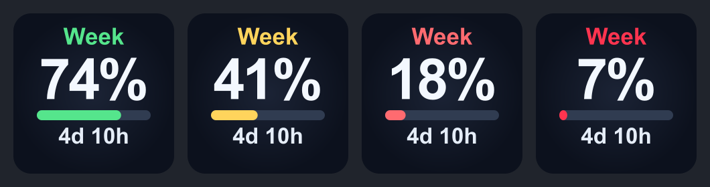
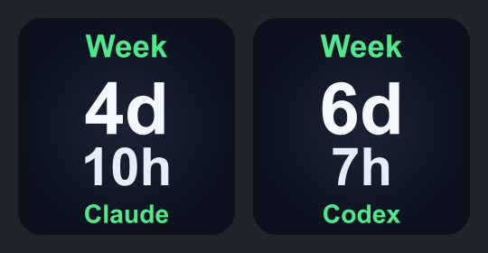
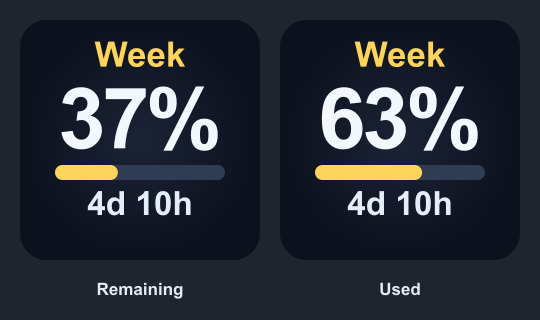

# Claude & Codex Weekly Usage


A small, local Stream Deck plugin for checking AI subscription capacity without copying session keys.

**Claude and Codex on macOS.** Six actions are included in one plugin: **Claude weekly remaining**, **Claude saved resets**, **Claude weekly countdown**, **Codex weekly remaining**, **Codex saved resets**, and **Codex weekly countdown**. Existing third-party plugins are not bundled.





The previews use example values and dates, not a real account snapshot.

## Features

- Weekly capacity as a large **Remaining** or **Used** percentage with a matching progress bar.
- A dedicated weekly countdown key: **Week**, large **days / hours**, and the exact local reset time.
- Saved reset inventory as `R1`, `R2`, `R3`, etc., with the earliest expiry date.
- `none` when the server confirms there are no saved resets.
- Configurable remaining-capacity thresholds and colors.
- Independent 60-second polling for Claude and Codex while their actions are visible.
- Claude keys share one request; Codex keys share one usage request and one reset-inventory request per poll.
- Automatic use of the existing Claude Desktop login and local Codex ChatGPT login on the same Mac.
- Unavailable states on keys and update diagnostics in action settings; errors never mean zero resets.
- Read-only monitoring: percentage keys toggle Remaining / Used; other keys check usage. No key redeems a reset.
- English-only interface, documentation, status labels, and date formatting; no language selector.

## Install

1. [Install and connect Stream Deck](docs/INSTALLATION.md#1-install-stream-deck).
2. Sign in to Claude Desktop and/or Codex with the subscription account you want to monitor. Codex requires a local file-backed ChatGPT login; see the installation guide.
3. Download the `.streamDeckPlugin` installer from the [latest release](https://github.com/Astakhoff/stream_deck_claude_codex_usage/releases/latest) and open it with Stream Deck.
4. In Stream Deck, find **Claude & Codex Weekly Usage** and drag the desired provider’s weekly and reset actions onto keys.
5. If macOS asks for access to **Claude Safe Storage**, review the request and allow access if you trust this plugin.

For a manual installation, source checkout, updates, removal, and troubleshooting, see the [installation guide](docs/INSTALLATION.md).

## Requirements and compatibility

| Component        | Support                                                                                                |
| ---------------- | ------------------------------------------------------------------------------------------------------ |
| Operating system | macOS 13 or later; the installed Stream Deck version may require a newer OS                            |
| Stream Deck app  | Manifest minimum 6.6; tested with 7.4.2                                                                |
| Claude Desktop   | Standard macOS installation and signed-in account; tested with 4.4212.0                                |
| Node runtime     | Node.js 20 supplied by Stream Deck; users do not need a separate Node install for release packages     |
| Devices          | Keypad actions; tested on Stream Deck XL                                                               |
| Windows / Linux  | Not implemented                                                                                        |
| Codex            | Local ChatGPT login in `~/.codex/auth.json`, or `CODEX_HOME/auth.json` when configured for Stream Deck |

Claude Desktop's credential cache and the Anthropic/OpenAI usage endpoints are internal interfaces. Future updates may require changes to this plugin. Multiple organizations are currently reported as `Multi org` rather than silently choosing one.

## Reading the keys

### Weekly remaining

The default **Remaining** mode shows the capacity left: `37%` means **37% left**. Press the percentage key to switch between **Remaining** and **Used**, or select **Used** in the key settings to show the spent capacity instead: the same reading becomes **63% used**. Each key saves its own mode. The bar follows the selected value—shrinking in Remaining mode and filling in Used mode. `6d 13h` below the bar is a live relative countdown: six full days and thirteen hours until reset. There is no clock-time line on percentage keys. The countdown uses the reset timestamp returned by the server.

| Remaining capacity | Default color |
| ------------------ | ------------- |
| Above 50%          | Green         |
| 50% or less        | Yellow        |
| 20% or less        | Red           |
| 10% or less        | Critical red  |

Select the key in Stream Deck to choose **Remaining / Used**, then change thresholds and colors. Warning colors always use remaining capacity, even in Used mode. Thresholds must satisfy `100 ≥ yellow > red > critical ≥ 0`.



### Weekly countdown

A separate key shows **Week** at the top, full days and remaining hours together on one large line, and the exact local reset time at the bottom. For example, `4d 10h` means four days and ten full hours until the next weekly budget reset. The enlarged bottom line shows the exact reset weekday and 24-hour time (for example, `Fri 21:00`) in your system timezone. The last partial hour shows `<1h`. No percentage or progress bar is shown on this key.

The countdown uses the same weekly reset timestamp and shared polling as the percentage key, so adding it does not increase network requests. An elapsed deadline is hidden until a new valid period arrives. Select the key to change its accent color.

### Saved resets

`R2` means two saved resets remain. `EXPIRES DEC 2` is the earliest expiry among the counted grants, in the Mac's local timezone. Select the key to see the complete list of expiry dates.

Expired, paused, not-yet-started, and exhausted grants do not count. A saved reset that requires reaching a usage limit before redemption still counts as saved. Unknown or malformed inventory displays `No data`; it never becomes `none` merely because the lookup failed.

## Privacy and authentication

Claude uses its encrypted Desktop OAuth cache and macOS Keychain. Codex uses the access token and account ID from its existing local ChatGPT `auth.json` file. API-key-only and Keychain-only Codex credentials are not supported by this reader.

Each provider sends read-only authenticated `GET` requests only to its own service: Anthropic's usage endpoint for Claude, and OpenAI's `chatgpt.com/backend-api/wham/usage` and `rate-limit-reset-credits` endpoints for Codex. Credentials are never shared between providers. The plugin does not write credentials, use refresh tokens, change either login, or send data to a project-owned server.

A local `status.json` contains usage and polling state only. It is excluded from Git and distribution packages. See [architecture and privacy details](docs/ARCHITECTURE.md).

## Development

Node.js 20+ and npm are required for development. From the repository root:

```sh
npm ci
npm run setup
npm test
npm run validate
npm run pack
```

The installer is written to `dist/`. The pack command uses Elgato's official Stream Deck CLI. Tests use synthetic credentials and inventories and do not access a live account. Deliberate live checks are available with `npm run check:live` (Claude) and `npm run check:live:codex` (Codex); they print usage data, never tokens.

See [CONTRIBUTING.md](CONTRIBUTING.md) for the project layout and contribution workflow.

## License

[MIT](LICENSE). This is an unofficial community project, not affiliated with Anthropic, OpenAI, or Elgato. Product names belong to their respective owners.

## Marketplace distribution

The [Marketplace submission materials](marketplace/README.md) include artwork, listing text, privacy information, AI assistance disclosure, and the author-qualified build instructions. The Marketplace build requires Stream Deck 6.9+ and uses the official SDK transport; the direct installer retains its original UUID and Stream Deck 6.6+ compatibility. These are separate install channels.
